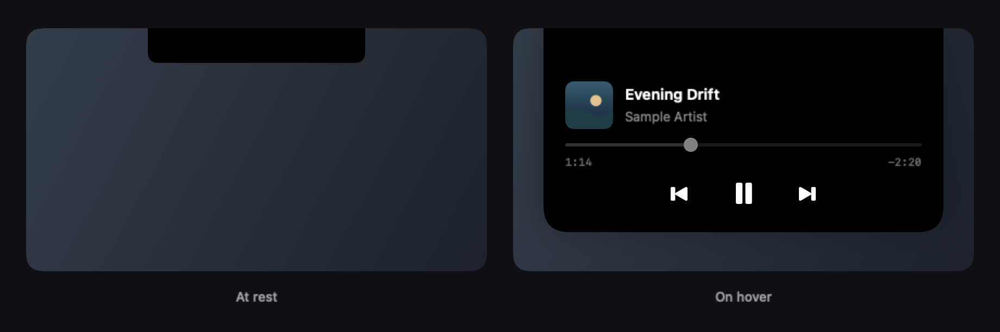

# Notch Media Island

**[English](README.md)** · **Türkçe**

Mouse'u üzerine getirdiğinizde MacBook çentiğinden genişleyen kompakt, siyah bir medya oynatıcı. SwiftUI/AppKit ile geliştirilmiştir; macOS'un Şu An Çalınan bilgilerini kullanır.



*Uygulamanın gerçek arayüz kodundan, kurgusal parça bilgileri ve özgün örnek kapakla oluşturulmuştur.*

**[Türkçe kurulum rehberi](docs/GETTING_STARTED.tr.md)** · **[English setup](docs/GETTING_STARTED.md)**

## Kod yazmadan başlatın

1. Repoyu clone'layın veya GitHub'da **Code → Download ZIP** ile indirip ZIP'i açın.
2. Proje klasöründeki **Start.command** dosyasına çift tıklayın.
3. Apple geliştirme araçları eksikse başlatıcı Apple'ın kurulum penceresini açmayı önerir. Kurulumu bitirip **Start.command** dosyasını yeniden açın.
4. İlk derlemeyi bekleyin. Uygulama **ana klasörünüzdeki Applications** klasörüne kurulup açılır. Mouse'u çentiğin üzerine getirin.

Sonraki açılışlarda ana klasörünüzdeki Applications içinden **Notch Media Island.app** dosyasını açın. Her seferinde derlemeniz gerekmez. Başlatıcı ilerlemeyi göstermek için Terminal kullanır; kod veya komut yazmanız gerekmez. macOS açılışı engellerse kurulum rehberine bakın.

**macOS 14 Sonoma veya daha yenisi** gerekir. Kaynaktan derlemek için **Swift 5.9+** içeren Apple Command Line Tools veya Xcode 15+ gerekir. Apple Silicon üzerinde yerel olarak test edilmiştir; CI hem Apple Silicon hem Intel için yapılandırılmıştır, ancak Intel'de gerçek cihaz üzerinde medya testi hâlâ gereklidir.

### Hazır uygulama

Bir sürüm yayımlandığında reponun **Releases** bölümünden Apple M-serisi için `arm64`, Intel için `x86_64` dosyasını indirin. ZIP'i açın, **Notch Media Island.app** dosyasını Uygulamalar'a sürükleyip açın. Geliştirici aracı gerekmez. Releases boşsa yukarıdaki kaynaktan kurulum yolunu kullanın.

Mevcut paketler **yerel ad-hoc imzalıdır; Developer ID ile imzalanmış veya notarize edilmiş değildir**. macOS indirilen uygulamayı engelleyebilir. Açmaya karar vermeden önce [Apple'ın güvenlik açıklamasını](https://support.apple.com/en-us/102445) ve kurulum rehberini okuyun.

## Özellikler

- Mouse ile genişleme; uzaklaşınca kısa gecikmeyle kapanma.
- Albüm kapağı, parça adı, sanatçı, yerleşik oynatma kontrolleri ve sürüklenebilir ilerleme çubuğu.
- İleri/geri sarmada anında görsel geri bildirim ve duraklatma/devam etme senkronu.
- Uyumlu uygulamalar ve tarayıcılar arasında macOS'un aktif Şu An Çalınan oturumunu takip etme.
- Menü çubuğundan gizle/göster, bağlantıyı yenile ve çıkış; Dock simgesi yok.
- Ekran değişiklikleri ve uyku/uyanma desteği; Hareketi Azalt ayarına uyum.

Uygulama arayüzü şu anda Türkçedir. Tüm eşzamanlı ses kaynaklarını listelemek yerine **sistemin aktif medya oturumunu** gösterir. Kaynağın Şu An Çalınan bilgilerini paylaşması gerekir; metadata, sarma ve parça değiştirme desteği oynatıcıya bağlıdır. Canlı/süresi bilinmeyen yayınlarda sarma kapalıdır. Uygulama ses kaydetmez, mikrofon/ekran kaydı/Erişilebilirlik izni istemez, telemetri göndermez ve dinleme geçmişini saklamaz. Oturum açılışında otomatik başlatılmaz.

## Geliştirici komutları

```sh
bash scripts/check-requirements.sh
bash scripts/run.sh                 # Derle ve build/ içinden aç
bash scripts/install.sh             # ~/Applications içine kur ve aç
swift test --disable-sandbox
bash scripts/package.sh             # dist/ altında ZIP + SHA-256 oluştur
```

Güncelleme kurmadan önce uygulamadan çıkın. Düzenlemek için `Package.swift` dosyasını Xcode'da açın; medya yardımcısını içeren çalıştırılabilir uygulama için betikleri kullanın. Homebrew, API anahtarı veya harici Swift bağımlılığı gerekmez. Apple araçları kurulduktan sonra yerel derleme ağdan dosya indirmez.

## Lisans ve dağıtım

Projenin özgün kodu: [MIT](LICENSE). Dahil edilen [MediaRemote Adapter](https://github.com/ungive/mediaremote-adapter): **BSD-3-Clause**; bildirimleri kaynakta ve uygulama paketlerinde korunur. [Üçüncü taraf bildirimleri](THIRD_PARTY_NOTICES.md) ve [yayın öncesi inceleme](docs/PUBLICATION_REVIEW.md) dosyalarına bakın.

Adaptör, macOS 15.4+ desteği için sistem Perl süreci üzerinden Apple'ın **private MediaRemote API'sini** kullanır. Apple bunu değiştirebilir; mevcut uygulama Mac App Store'un public API şartına uygun değildir. Proje bağımsızdır; Apple ile bağlantılı değildir ve adaptör yazarlarının onayını taşıdığı iddia edilmez. Apple framework dosyaları, albüm kapakları veya ses kayıtları dağıtılmaz.

[Testler](docs/TESTING.md) · [Katkıda bulunma](CONTRIBUTING.md) · [Yayınlama](docs/RELEASING.md)
